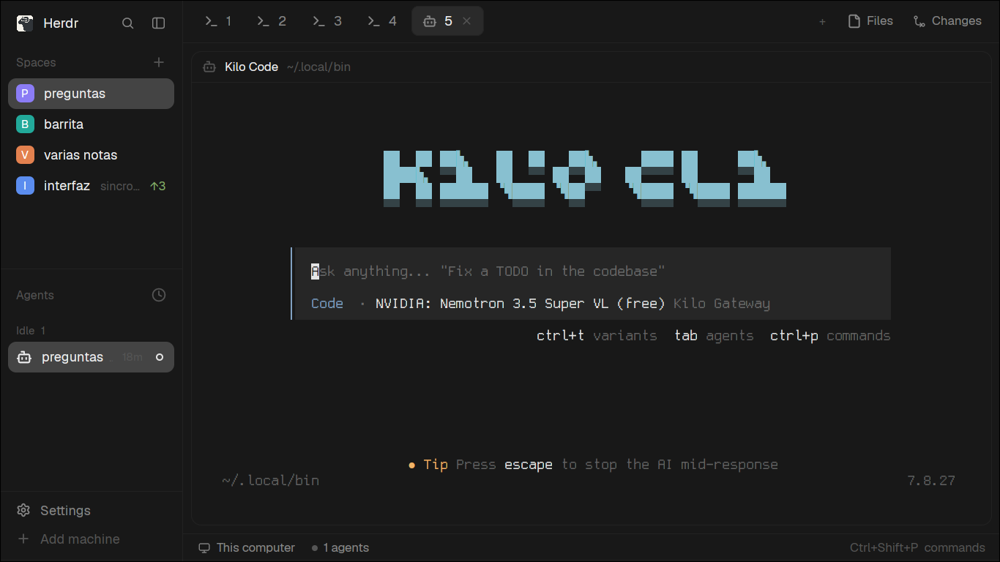
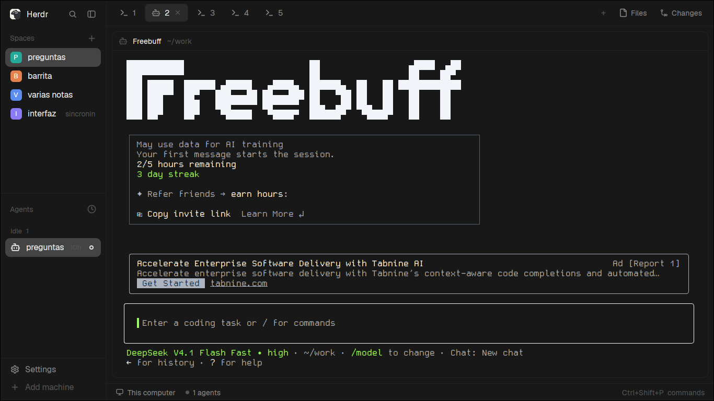

# herdr-status-plugins

Mods for the [Herdr app](https://herdr.dev): terminal status bridges for coding agents via OSC 7501.

Each folder is one mod, in the form that [herdr.dev/mods](https://herdr.dev/mods) lists: `<name>/mods/<name>/` is the mod, `<name>/README.md` tells how to install and use it, `RECIPE.md` is the brief an agent can rebuild it from, and `preview.png` shows it.

## Mods in this repo

| Mod | What it does | Needs |
| --- | --- | --- |
| [kilo-status](./kilo-status) | Kilo Code terminals report their status (working, done, blocked, idle) to Herdr's Agents panel via OSC 7501 | — |
| [freebuff-status](./freebuff-status) | Freebuff terminals report their turn state (working, done, blocked, idle) to Herdr's Agents panel via OSC 7501, driven by Freebuff's own chat log | — |





## Install

Copy a mod, then run the setup command it prints. Both steps are needed for a mod that installs something inside the agent.

```
./install.sh kilo-status
node ~/.config/herdr-app/mods/kilo-status/status.mjs install

./install.sh freebuff-status
node ~/.config/herdr-app/mods/freebuff-status/status.mjs install
```

`./install.sh` with no arguments copies every mod. Each mod's README has the details, the uninstall steps and what the mod touches.

Or copy a mod folder by hand:

```
cp -R kilo-status/mods/kilo-status ~/.config/herdr-app/mods/
node ~/.config/herdr-app/mods/kilo-status/status.mjs install

cp -R freebuff-status/mods/freebuff-status ~/.config/herdr-app/mods/
node ~/.config/herdr-app/mods/freebuff-status/status.mjs install
```

The mods are copied, not linked, because Herdr does not load icons or hot reload a mod whose folder is a symlink. `install.sh` replaces the destination folder, so local edits inside `~/.config/herdr-app/mods/` are lost on reinstall.

## Add a mod

1. Make the folder `<name>/mods/<name>/` with `main.js` and `mod.json`.
2. Add `<name>/README.md`, a `RECIPE.md`, and a `preview.png`.
3. Add a row to the table above. If the mod imports another mod, write that mod under "Needs".
4. If the mod installs something inside the agent, add `status.mjs` with `install`/`uninstall`/`doctor`/`path`, like the two existing mods.

`./install.sh` finds the new mod with no change. A mod cannot import a file from another mod (`herdr-app check` refuses it), so a mod that needs code from another one keeps its own copy.

## Development

Each mod has its own tests and no dependencies:

```
cd kilo-status && npm test
cd freebuff-status && npm test

herdr-app check kilo-status/mods/kilo-status
herdr-app check freebuff-status/mods/freebuff-status
```

## Licence

MIT (`LICENSE`).
