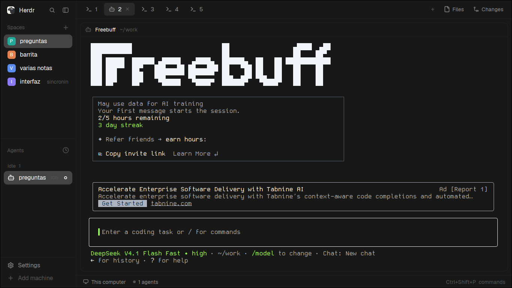

# Freebuff Status

Freebuff (`freebuff`) terminals report their status to Herdr, so they appear in the Agents panel as working, done, blocked or idle with Freebuff's name and the conversation's first prompt. The Herdr mod itself draws nothing; it is the folder that carries and installs the wrapper and the watcher.

## What you see

Nothing in the window. The mod has `"place": "none"` in `mod.json`, so it never docks a panel.

What changes is the Agents sidebar: a `freebuff` terminal that used to have no status now appears under **Freebuff**, with the first prompt of the conversation as its title. The status dot follows the turn: a spinner while Freebuff works, a blocked mark while it waits for an `ask_user` answer or for a login, **done** after a turn finishes until the person looks at that terminal, and **error** when a run fails. The terminal header shows the same word.

## How it behaves

| Freebuff event | Herdr status |
| --- | --- |
| the wrapper starts inside Herdr | `idle` |
| `[send-message] Sending message with sdk run config` | `working` |
| `[message-queue] Processing next message from queue` | `working` |
| `Main prompt finished` | `done` |
| `Agent run cancelled by user (abort error)` | `done`, `msg=cancelled` |
| `ask_user` without an answer yet | `blocked`, `kind=question`, the question as `msg` |
| `No authentication token found` / `Please run the login flow` | `blocked`, `kind=auth` |
| `Error in AI SDK stream` / `startAgentRun error` / `finishAgentRun error` | `error`, the message as `msg` |
| `Network error, retrying` / `Health check failed` during a turn | `working`, the retry message as `msg` |
| Freebuff exits, or the watcher gets SIGINT/SIGTERM | `clear` |

A report replaces the whole record, so every report repeats `app=freebuff` and the current title. Identical reports are dropped. The title changes once, when `chat-meta.json` appears with `firstPrompt`.

`done` becomes `idle` in Herdr once the person looks at that terminal.

## Why this way

Kilo could be done with a server plugin because Kilo has one. Freebuff does not: there is no plugin API, no hook system, and no headless or `--print` mode yet ([CodebuffAI/freebuff#947](https://github.com/CodebuffAI/freebuff/issues/947)). The only supported things it exposes are its own files.

So the bridge is out of band:

- A `freebuff` wrapper in `~/.local/bin` shadows the real binary. Inside Herdr it starts the watcher in the background and then `exec`s the real binary, so the process id stays the same and the pty is never proxied.
- The watcher reads `~/.config/manicode/projects/<project>/chats/<timestamp>/log.jsonl`, which Freebuff writes anyway, and turns the turn boundaries into OSC 7501.
- Nothing sits between the keyboard and Freebuff. If the watcher dies, Freebuff keeps working and only the status stops.

The alternative, a PTY proxy that scrapes the screen like Orca does, would see the login and trust prompts, but it puts a parser in the I/O path and breaks when Freebuff's UI changes. Reading the log is cheaper and safer; the two screen-only prompts are the price.

## Built from

- `mods/freebuff-status/mod.json`: `{ "place": "none", "title": "Freebuff Status" }`.
- `mods/freebuff-status/main.js`: an empty `View` with `div().id("freebuff-status")`; it makes the folder a valid Herdr mod and renders nothing. Freebuff is launched from Herdr's program menu (registered in `programs.json`) or by typing `freebuff`, so the wrapper is used either way.
- `mods/freebuff-status/herdr-report.mjs`: OSC 7501 encoding, sanitising, caps, tty resolution (`/dev/tty`, then stdout/stderr/stdin if they are ttys, then ancestor ttys via `ps -o tty=,ppid=`), and a reporter with dedupe and `clear`.
- `mods/freebuff-status/freebuff-log.mjs`: chat discovery (`listChats`, `findChatByPid`, `newestChat`), `pidTree` (the writer is a child of the TUI), title (`readChatTitle`, `fallbackTitle`), the incremental `createLogReader`, and the `createClassifier` state machine.
- `mods/freebuff-status/freebuff-watcher.mjs`: the background entry point. Reports `idle` at startup (the terminal is an agent before any chat exists), finds the chat by pid tree, follows the log with `fs.watch` plus a 1 s safety tick, refreshes the title, and clears on exit.
- `mods/freebuff-status/status.mjs`: `install`, `uninstall`, `doctor`, `path`. It writes the wrapper, updates `programs.json` (name `Freebuff`, icon `mods/freebuff-status/robot.svg`, `tint: true`, `run: ["freebuff"]`), backs up a foreign wrapper once, removes the old standalone watcher if it is ours, and reports the paths.
- `mods/freebuff-status/robot.svg`: the robot glyph Herdr uses for agents (Lucide "bot", ISC), copied into the mod so it does not depend on the shipped `icons/` folder, which Herdr rewrites on updates.
- `package.json`: `npm test` runs `node --test`.
- `test/report.test.js`: OSC bytes, sanitising, UTF-8 caps, dedupe, title re-emit, `clear`, opt-out.
- `test/log.test.js`: turn start/finish, sub-agent steps, abort, auth, error, retry gating, `ask_user` question and answer, incremental reader, truncation, pid selection, title.
- `test/status.test.js`: temp `HOME`, install/idempotence/backup/uninstall/refusal, customised program entry, `doctor`, `path`.

The protocol details come from [OSC 7501](https://areweosc7501yet.com/) and Herdr's parser: `state` is `idle|working|done|blocked|error|clear`, `kind` is `permission|question|auth`, `app` is `[A-Za-z0-9_.+-]{1,32}`, `title` is at most 192 decoded bytes, `msg` at most 2048, and the whole sequence at most 4096. `app=freebuff` matches the `freebuff` program registered in `programs.json`.

## Watch out

- `Start agent … step N` and `End agent … step N` are **sub-agent steps**, not turn boundaries. A turn opens with `[send-message] Sending message with sdk run config` and closes with `Main prompt finished`. Treating `End agent` as a finish makes the status flicker many times per turn; that was the first version's bug.
- `Freebuff session over; holding queued messages until rejoin` also appears at startup. It is not a finish; ignore it.
- `Health check failed` and `Network error, retrying` only count while a turn is active (`startTs > finishTs`); a periodic health check while idle must not report `working`.
- The chat must be chosen by pid, not by "newest folder". With two Freebuff panes, the newest folder belongs to one of them and the other panel reports the wrong state. Every log line has `"pid":<n>` — but that is **not** the TUI's pid: Freebuff spawns `~/.config/manicode/freebuff`, and that child writes the log. Matching only `HERDR_FREEBUFF_PID` never hits and the watcher silently waits for the 5 s fallback. Resolve the pid tree (`pidTree`) and match any of them, excluding the watcher's own pid (it is a child of the TUI too).
- A resumed session keeps its old folder, so the newest-folder heuristic is also wrong there; the pid in the appended lines is right.
- Report `idle` before the chat is found. The chat folder only appears after Freebuff starts, and `chat-meta.json` only after the first message; without the early report the terminal is not an agent for the first seconds and the panel looks broken.
- The log grows to megabytes in a long session. Never `readFileSync` it on every tick: keep an offset, decode only complete lines, reset on truncation or inode change. The first read of an existing log is the only full pass.
- The wrapper must skip itself when scanning `PATH`, or `exec` recurses forever. It compares `pwd -P` of the candidate's directory plus the basename, so it works without `readlink -f` (macOS).
- The wrapper is a real file in `~/.local/bin`, not a symlink: a user who already has a `freebuff` there gets a one-time `freebuff.freebuff-status-backup`.
- The mod's `main.js` must not install anything at import time; Herdr loads it in the app process. `status.mjs install` is the only installer.
- `uninstall` must not delete a wrapper or a program entry it did not write. The marker is `# freebuff-status wrapper`; a customised program entry (extra keys) is left alone.
- The login prompt and the `.agents` trust prompt are screen-only. Do not try to infer them from the log; report `idle` until the first message.
- A report is a snapshot, not a patch: forgetting `app` or `title` on a later report makes them disappear.

## Done when

- `npm test` passes the report, log and installer tests.
- `herdr-app check mods/freebuff-status` exits 0.
- `node mods/freebuff-status/status.mjs install` followed by `doctor` reports `"installed": true`, `"wrapperOurs": true`, `"upToDate": true`, `"program": true`.
- In a Herdr terminal, starting `freebuff` through the wrapper makes `hc get --json <terminal>` show `"reported": true`, `"app": "freebuff"`, `"status": "idle"` within a second, before any prompt is sent.
- Sending a prompt moves that terminal to `working`; `Main prompt finished` moves it to `done`; looking at it turns `done` into `idle`; an `ask_user` dialog moves it to `blocked` with `kind=question`.
- Two Freebuff panes at once keep independent statuses.
- `FREEBUFF_HERDR_STATUS=0` in a new Freebuff terminal leaves `reported` false.
