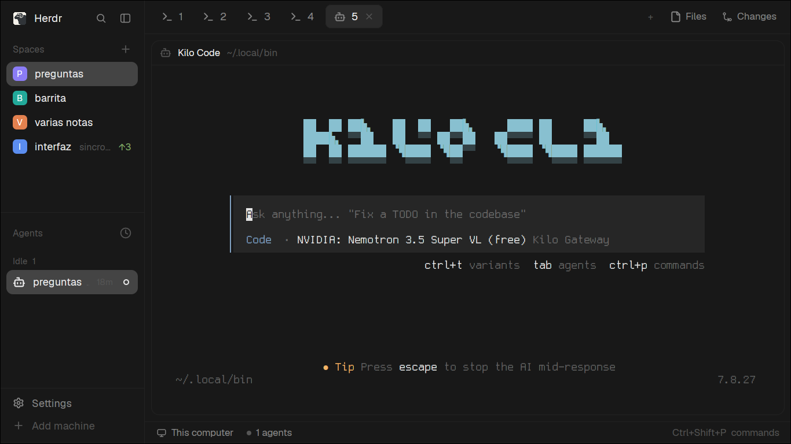

# Kilo Status

Kilo Code (`kilo`) terminals report their status to Herdr through a small Kilo server plugin, so they appear in the Agents panel as working, blocked, done or idle with Kilo's name and icon. The Herdr mod itself draws nothing; it is the folder that carries and installs the plugin.

## What you see

Nothing in the window. The mod has `"place": "none"` in `mod.json`, so it never docks a panel.

What changes is the Agents sidebar: a `kilo` terminal that used to have no status now appears under **Kilo Code**, with the program's icon and its session title. The status dot follows the turn: a spinner while Kilo works, a blocked mark while it waits for a permission or an answer, and **done** after a turn finishes until the person looks at that terminal. The terminal header also shows the same word.

The preview shows the Agents sidebar with three Kilo terminals, one of them the focused pane.

## How it behaves

| Kilo event | Herdr status |
| --- | --- |
| plugin loads | `idle` |
| `chat.message`, `tool.execute.before`, `tool.execute.after`, `command.execute.before` | `working` |
| `session.status` `busy` | `working` |
| `session.status` `retry` | `working`, with `Retrying (n): <message>` |
| `permission.asked` / `permission.v2.asked` | `blocked`, `kind=permission`, message `permission: patterns` |
| `question.asked` / `question.v2.asked` | `blocked`, `kind=question`, message is the first question |
| `session.error` `ProviderAuthError` | `blocked`, `kind=auth`, message from the error |
| `session.error` `MessageAbortedError` | `idle` |
| any other `session.error` | `error`, message from the error |
| `permission.replied`, `permission.v2.replied`, `question.replied`, `question.rejected`, `session.compacted` | `working` |
| `session.idle` | `done` |
| `session.deleted` | `clear` |
| plugin `dispose` or process `exit` | `clear` |

A report replaces the whole record, so every report repeats `app=kilocode` and the current title. Identical reports are dropped. A late `session.status: idle` is ignored while the last word is `done` or `error`, so a finished or failed turn stays visible. Sub-agent sessions are tracked from `session.created`/`session.updated` (`info.parentID`); their `idle` is ignored, so a child cannot finish the parent's turn.

`done` becomes `idle` in Herdr once the person looks at that terminal.

## Built from

- `mods/kilo-status/mod.json`: `{ "place": "none", "title": "Kilo Status" }`.
- `mods/kilo-status/main.js`: an empty `View` with `div().id("kilo-status")`; it makes the folder a valid Herdr mod and renders nothing.
- `mods/kilo-status/herdr-agent-state.ts`: the Kilo server plugin. Default export `{ id: "herdr-kilo-status", server }`. It maps the events above, resolves a terminal (`/dev/tty`, then stdout/stderr/stdin if they are ttys, then ancestor ttys via `ps -o tty=,ppid=`), encodes `ESC ]7501;…ESC \` with base64 `title`/`msg`, dedupes, and clears on exit.
- `mods/kilo-status/status.mjs`: `install`, `uninstall`, `doctor`, `path`. Kilo's config folder is `$KILO_CONFIG_DIR`, else `$XDG_CONFIG_HOME/kilo`, else `~/.config/kilo`; the plugin goes in its `plugin/` subfolder, which Kilo auto-loads (`{plugin,plugins}/*.{ts,js}`).
- `package.json` (root): `npm test` runs `node --test`. `mods/kilo-status/package.json` is `{ "type": "module", "private": true }` for the mod folder.
- `test/plugin.test.js`: imports the `.ts` plugin, injects a writer, checks the OSC bytes, limits, dedupe, title, event mapping, sub-agent filter, error mapping and `clear`.
- `test/status.test.js`: temp `HOME`, checks install/idempotence/backup/uninstall/refusal, `KILO_CONFIG_DIR`, and `doctor`.

The protocol details come from [OSC 7501](https://areweosc7501yet.com/) and Herdr's parser: `state` is `idle|working|done|blocked|error|clear`, `kind` is `permission|question|auth`, `app` is `[A-Za-z0-9_.+-]{1,32}`, `title` is at most 192 decoded bytes, `msg` at most 2048, and the whole sequence at most 4096. `app=kilocode` is the key of Herdr's `kilocode` program in `programs.json`, so Kilo gets its own name and icon.

## Watch out

- Kilo reads server plugins only at start. A running session keeps the old behavior until it restarts. The plugin also does nothing outside Herdr, because `HC_TERMINAL_ID` is unset there.
- Kilo 7.8 is a single Bun process that owns the pty, so `/dev/tty` works. A future version that forks a server without a controlling terminal needs the ancestor-tty fallback, which is why it is there; if no tty is found the plugin stays silent.
- Do not also alias `kilo` to a wrapper that reports status: two reporters fight over the same record.
- `session.deleted` must be filtered by session id. Clearing on any deletion would wipe the visible session when a sub-agent or another session is removed.
- A report is a snapshot, not a patch: forgetting `app` or `title` on a later report makes them disappear.
- Base64 is standard, padded base64. `msg`/`title` must be single-line: newlines, tabs and other control characters are replaced with spaces before encoding.
- The mod's `main.js` must not do the install at import time; Herdr loads it in the app process, while the plugin belongs to Kilo. `status.mjs install` is the only installer.
- The plugin filename is fixed (`herdr-agent-state.ts`). `uninstall` refuses to delete a file without the `// herdr-kilo-status` marker unless `--force` is passed.

## Done when

- `npm test` passes all plugin and installer tests.
- `herdr-app check "$PWD/mods/kilo-status"` exits 0 (it prints nothing and writes no visible UI).
- `node mods/kilo-status/status.mjs install` followed by `doctor` reports `"installed": true`, `"upToDate": true`.
- In a Herdr terminal, `hc get --json <terminal>` after starting `kilo` shows `"reported": true`, `"app": "kilocode"`, and `"status": "idle"`.
- Sending a prompt moves that terminal to `working`; a permission prompt moves it to `blocked` with `kind=permission`; finishing the turn moves it to `done`; looking at the terminal turns `done` into `idle`.
- `KILO_HERDR_STATUS=0` in a new Kilo terminal leaves `reported` false.
